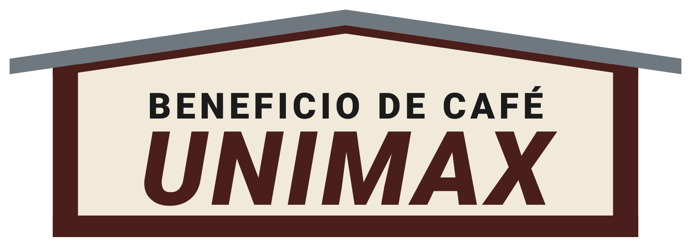

<p align="center"></p>

# Beneficio Unimax: contabilidad de compra de café

Programa de escritorio para Windows (C++) que lleva la contabilidad de un beneficio de café:
compra de café **uva, pergamino húmedo y pergamino seco**, comprobantes de compra, precio del día,
deudas con clientes y productores, caja diaria y ventas. Usa una base de datos **Microsoft Access**
(`.accdb`) y genera los comprobantes y reportes con **plantillas de Excel**.

---

## 1. Qué hace el programa (una sección por tarea)

La ventana tiene una **barra café** arriba (logo, nombre de la sección, alertas, fecha y el usuario) y un
**menú lateral** a la izquierda con las secciones. El menú completo (Archivo, Sesión, Ver, Nube y Ayuda) se
abre haciendo clic en el **nombre del usuario**, arriba a la derecha. Abajo del menú lateral se ve el estado de
**Google Drive**. En pantallas pequeñas (laptops) el menú lateral muestra solo los íconos; al pasar el ratón
aparece el nombre. Todo se acomoda solo al tamaño de la ventana y de la pantalla.

Para elegir un cliente (en Comprobante, Ventas y Nuevo préstamo) se escribe el **nombre o el DNI** en el
buscador y se elige de la lista; al final de la lista está **"+ Registrar cliente nuevo"**. En Facturas,
Ventas y Reportes el período se elige de una lista (Hoy, Esta semana, Este mes, Mes anterior, Esta cosecha,
Este año o Elegir fechas).

| Sección | Para qué sirve |
|---|---|
| **Ingreso** | Al abrir, el programa pide **usuario y contraseña** (ver la sección 3). |
| **Inicio** | Panel con el resumen: café **uva** y **pergamino** comprado hoy (libras, quintales, lempiras, mes y cosecha), **dinero en caja** (en rojo si está bajo el mínimo), **deudas** (lo que nos deben y lo que debemos), gráfico de **compras por mes** de la cosecha, anillo con el reparto **por tipo de café**, **deudas que vencen pronto**, **café en bodega** (compras menos ventas, por tipo) y **mejores productores del mes**. Al hacer clic en una tarjeta se abre la sección correspondiente. |
| **Comprobante de compra** | Se escribe el DNI del productor (si ya existe, aparece su nombre; si no, se registra al guardar). Se agregan líneas de café pesado: tipo, peso en **libras o quintales**, **galones** (como dato) y precio por libra. El programa calcula los subtotales, el total, lo **pagado en efectivo** y el **saldo** que queda debiendo el beneficio, con una fecha de pago opcional. En el campo DNI también se puede escribir el **nombre** y presionar Enter para buscarlo. **Guardar e imprimir** manda el comprobante directo a la impresora; **Guardar** lo muestra dentro del programa. |
| **Informe del día** | Botón en *Comprobante de compra* (y en *Reportes* y el menú *Ver*): libras y quintales de **uva**, **pergamino húmedo** y **pergamino seco** por separado, del día, del mes y de la cosecha (desde el 1 de octubre). Se ve dentro del programa y se imprime. El **reporte general** (Excel) tiene una fila por día de la cosecha y se vuelve a crear con los datos al día. |
| **Facturas** | Una **carpeta por cliente** con todos sus comprobantes. Doble clic para **verlo dentro del programa** (sin Excel), imprimirlo, abrir su PDF o **anular** (devuelve el pago a la caja y anula el saldo pendiente). |
| **Clientes** | Productores y compradores: nombre, DNI/RTN, teléfono, dirección. Muestra cuánto les debe el beneficio y cuánto le deben. Genera el **estado de cuenta** en Excel. |
| **Precio del día** | Precio por libra de cada tipo de café para cada fecha. Se puede escribir por libra o por quintal (el otro se calcula solo). Se pone solo en los comprobantes del día y se puede cambiar en un comprobante en particular. |
| **Deudas** | Lo que **el beneficio debe** (saldos de comprobantes, dinero recibido) y lo que **le deben al beneficio** (préstamos, adelantos, saldos de ventas). Registra abonos, muestra vencidas en rojo y permite anular. |
| **Caja** | **Restante del día anterior** + entradas − salidas = **debe haber en caja**. Se escribe el **dinero contado** y se **cierra la caja**; lo contado pasa a ser el saldo inicial del día siguiente. Todas las compras, abonos, préstamos y ventas se anotan solos en la caja. |
| **Ventas** | Venta de café a exportadoras u otros compradores (con cobro total o parcial). |
| **Reportes** | Compras del período, ventas del período, caja por día, cierre de un día, deudas pendientes y estado de cuenta de un cliente (en Excel), informe del día y **café en bodega** (en pantalla e imprimible). |
| **Configuración** | Datos de la empresa para los comprobantes, saldo inicial de caja, numeración, recordatorio diario, respaldo de la base de datos. |

**Recordatorio diario de deudas** de dos formas:
1. **Al abrir el programa** (una vez al día) aparece una ventana con las deudas vencidas, las que vencen hoy y las que vencen pronto. También avisa si falta el precio del día o si quedó una caja sin cerrar.
2. **Aviso de Windows** a la hora que usted elija, aunque el programa esté cerrado. Se activa en *Configuración → Activar aviso de Windows* y usa el Programador de tareas de Windows.

**Facturas de uva y de pergamino van aparte**, cada una con su numeración: `U-000001` (uva) y `P-000001`
(pergamino; el húmedo y el seco pueden ir juntos). La factura muestra en una franja de color si es
**CAFÉ UVA** o **CAFÉ PERGAMINO**, e incluye el RTN y el carnet IHCAFE del productor si los tiene.

**Alerta de caja:** después de cada pago, si en caja quedan menos de L 5,000 (se cambia en *Configuración*),
aparece un aviso; mientras siga así se ve en rojo en el encabezado y en la pestaña *Caja*.

**Imprimir** envía la factura directo a la impresora física (nunca a "Microsoft Print to PDF"). Si no hay
impresora conectada, avisa que la factura ya está guardada en PDF.

**Pantalla:** el programa se abre a pantalla completa y elige solo el tamaño de letra para que las pestañas,
los botones y las tablas aprovechen toda la pantalla. Si cambia el tamaño de la ventana, los botones, letras y
tablas se agrandan o achican con ella.

**Marca de agua:** las facturas llevan siempre el sello redondo (opción 2) y la pestaña *Comprobante de compra*
muestra el logo tenue al centro. Para las tablas del programa y los reportes de Excel se elige en
*Configuración → Marca de agua*:
- **Opción 1:** "UNIMAX" en diagonal con granos de café.
- **Opción 2:** sello redondo con un grano de café.
- **Sin marca de agua.**

Cada comprobante se guarda también en PDF en `Documentos\BeneficioUnimax\Documentos\Facturas\<Cliente (DNI)>`.

---

## 2. Reglas del negocio

Estas reglas salen de sus respuestas. Si alguna no es correcta, se puede cambiar.

- **País:** Honduras. Moneda: Lempiras (L).
- **DNI:** 13 dígitos (`0801-1990-12345`). El programa revisa el formato: departamento 01–18 y año válido. También acepta **RTN de 14 dígitos** para empresas como las exportadoras.
- **Peso:** el pago **siempre se calcula por libra**. Si se escribe en quintales, se convierte (**1 quintal = 100 libras**). Los **galones** se guardan solo como dato de referencia, porque primero se pesa y luego se calcula el precio.
- **Sin descuentos** de peso (ni tara ni humedad): se paga el peso de la báscula.
- **Precio del día:** uno por tipo de café; se puede cambiar en un comprobante en particular.
- **Comprobante interno**, con número correlativo propio. No es una factura fiscal del SAR.
- **Deudas:** el beneficio le debe al productor (saldo que no se pagó en la compra) y el productor le debe al beneficio (préstamo o adelanto). Las deudas **no se descuentan solas** de una compra: si un productor paga con café, se registra la compra y luego un abono a su deuda.
- **Caja:** registra compras, ventas, abonos y préstamos. También permite **entradas o salidas manuales** para casos como el fondo inicial, un retiro del dueño o un gasto.
- Un día con **caja cerrada** queda bloqueado. Para corregirlo, se reabre (solo el último cierre). Las anulaciones se registran en la caja **del día en que se anula**.

---

## 3. Usuarios y contraseñas

- **Primer ingreso:** usuario **`admin`**, contraseña **`Unimax2026`**. En ese primer ingreso el programa pide
  una **contraseña maestra nueva** y muestra un **código de recuperación**: anótelo y guárdelo fuera de la
  computadora. Si olvida la contraseña, use *¿Olvidó su contraseña?* en la ventana de ingreso con ese código.
- **Roles:** *Administrador* (todo) y *Operador* (registra compras, ventas, deudas y caja).
- Estas acciones piden la contraseña de un administrador: anular comprobantes, ventas, deudas o abonos;
  reabrir la caja; eliminar movimientos manuales; modificar o eliminar clientes; guardar la configuración;
  administrar usuarios. Un administrador no la vuelve a escribir durante 5 minutos.
- Menú *Sesión*: cambiar mi contraseña, usuarios y cerrar sesión. Cada operación guarda el usuario que la hizo.
- Las contraseñas se guardan cifradas (PBKDF2-SHA256), no se pueden leer abriendo la base de datos.

---

## 4. Requisitos

- Windows 10 u 11 de **64 bits**.
- Microsoft Office de **64 bits** con **Excel** y **Access**. El programa usa el controlador de Access que viene con Office.
- Para compilar: **Visual Studio 2022** (o más reciente) con la carga de trabajo **"Desarrollo para el escritorio con C++"**. Ya incluye CMake; no hace falta instalar nada más.

---

## 5. Compilar en Visual Studio

1. Descargue el proyecto: en GitHub, botón **Code → Download ZIP**, y descomprímalo. También puede clonarlo con Git.
2. Abra Visual Studio y elija **Archivo → Abrir → Carpeta...** y seleccione la carpeta del proyecto (la que tiene `CMakeLists.txt`).
3. Espere a que termine "Generación de CMake" (abajo, en la ventana *Salida*).
4. En la lista de configuraciones de la barra superior elija **x64 Release (64 bits, para usar)**.
5. Menú **Compilar → Compilar todo**.
6. En el selector de elemento de inicio (botón ▶) elija **BeneficioUnimax.exe** y presione **Ctrl+F5**.

El programa queda en `out\build\x64-release\BeneficioUnimax.exe`, junto con la carpeta `plantillas`.

**Por línea de comandos** (desde *Developer PowerShell for VS*):

```powershell
cmake -S . -B build -A x64
cmake --build build --config Release
# Resultado: build\Release\BeneficioUnimax.exe
```

**Sin compilar (descarga directa, un solo archivo):** cada vez que se suben cambios a GitHub, el
programa se compila con Visual Studio y se publica en *Releases*. Este enlace siempre descarga la última versión:

<https://github.com/konlink69-source/Beneficio-Unimax/releases/latest/download/BeneficioUnimax.exe>

1. Al terminar la descarga, haga clic en **Abrir archivo**. No hay que descomprimir nada: las plantillas de Excel van dentro del programa.
2. Si Windows muestra *"Windows protegió su PC"*, haga clic en *Más información → Ejecutar de todas formas*. El programa no tiene firma digital comercial.
3. El programa pregunta si desea instalarlo. Si elige **Sí**, se copia a `%LOCALAPPDATA%\Programs\BeneficioUnimax` (no requiere permisos de administrador) y se crea el ícono **Beneficio Unimax** en el escritorio y en el menú Inicio. Desde entonces se abre con doble clic en ese ícono.

Para actualizar, descargue y abra el nuevo `.exe` y elija **Sí**; sus datos no cambian. Si eligió **No**, puede
instalarlo después desde *Archivo → Instalar en esta computadora*.
Mientras el repositorio sea privado, el enlace pide iniciar sesión en GitHub con una cuenta que tenga acceso.

### Instalarlo para el uso diario

Abra `BeneficioUnimax.exe` y responda **Sí** cuando pregunte si desea instalarlo: se crea el ícono en el
escritorio. Al probarlo desde Visual Studio puede responder **No** (no se vuelve a preguntar) o abrirlo
con el argumento `/noinstalar`.

---

## 6. Dónde quedan sus datos

La primera vez que se abre, el programa crea esta carpeta:

```
Documentos\BeneficioUnimax\
├── BeneficioUnimax.accdb      ← base de datos de Access (todos los registros)
├── Plantillas\                ← plantillas de Excel (puede personalizarlas)
├── Documentos\
│   ├── Comprobantes\          ← comprobantes de compra generados
│   ├── Caja\                  ← cierres de caja
│   ├── Estados de cuenta\
│   └── Reportes\
└── Respaldos\                 ← copias de seguridad
```

- La base de datos se puede **abrir con Access** para consultas propias, pero no cambie la estructura de las tablas.
- **Respaldo automático en la computadora:** al salir del programa y al cerrar la caja se guarda una copia del
  día en `Respaldos\Automáticos` (se conservan las últimas 30). Con Google Drive conectado (sección 6.1) además
  se guardan copias en la nube. También puede hacer una copia a mano: *Archivo → Respaldar base de datos...*
- Para usar otra carpeta, por ejemplo una carpeta compartida, abra el programa con: `BeneficioUnimax.exe /datos "D:\Contabilidad"`.

### 6.1 Google Drive: respaldos automáticos y trabajar desde otra computadora

Con Google Drive conectado, el programa guarda sus datos en la carpeta **Beneficio Unimax** de su Drive:

```
Mi unidad\Beneficio Unimax\
├── BeneficioUnimax.accdb   ← los datos más recientes (clientes, facturas, caja, usuarios y contraseñas)
├── estado.json             ← versión de los datos y qué computadora los tiene abiertos
├── Respaldos\              ← copias con fecha
├── Documentos\             ← copia de los comprobantes PDF y reportes
└── Plantillas\             ← copia de las plantillas (con las versiones anteriores)
```

**Cuándo se guarda:** al **cerrar la caja**, al **salir del programa**, **cada hora** si hubo cambios y con
*Nube → Guardar en Google Drive ahora*. Si no hay Internet se sigue trabajando normal y los cambios se suben
cuando vuelva la conexión.

**Respaldos que se conservan:** todos los de las últimas 48 horas, uno por día del último mes y uno por mes
de antes. Para verlos o volver a uno: *Nube → Respaldos en Google Drive*. Al restaurar, los datos actuales se
guardan antes como respaldo, así que se puede deshacer. Restaurar pide la contraseña de un administrador.

**Seguir trabajando en otra computadora:**
1. Instale el programa en la otra computadora (mismo enlace de descarga).
2. Al abrirlo por primera vez pregunta *"¿Ya usa Beneficio Unimax en otra computadora...?"*: elija **Sí** y
   entre con la **misma cuenta de Google**. Se descargan todos los datos, con los mismos usuarios y contraseñas.
3. Desde ahí, cada vez que abra el programa en cualquiera de las dos computadoras, toma los datos más
   recientes que se subieron desde la otra.

**Si el programa está abierto en otra computadora**, se abre en modo **SOLO CONSULTA**: se ven los datos (la
última copia subida) pero no se puede registrar ni cambiar nada, para que no se mezclen. Para trabajar ahí,
cierre el programa en la otra computadora y vuelva a abrirlo. Si una computadora se apagó sin cerrar el
programa (se fue la luz), queda liberada sola a los 20 minutos.

**Si hay cambios en las dos** (por ejemplo, una trabajó sin Internet), al abrir el programa pregunta qué datos
usar. Los otros no se pierden: quedan como respaldo en Drive.

La impresora elegida es de cada computadora; el resto de la configuración viaja con los datos.

#### Preparar Google Drive (una sola vez)

Google exige que el programa esté registrado como "aplicación" en una cuenta de Google Cloud (es gratis).
Esto se hace **una sola vez** y sirve para todas las computadoras:

1. Entre a <https://console.cloud.google.com/> con su cuenta de Google y cree un proyecto (por ejemplo
   *Beneficio Unimax*).
2. Menú **APIs y servicios → Biblioteca**: busque **Google Drive API** y presione **Habilitar**.
3. **APIs y servicios → Pantalla de consentimiento de OAuth** (o *Google Auth Platform*): tipo **Externo**,
   nombre *Beneficio Unimax*, su correo como contacto. En *Permisos* (scopes) agregue
   `https://www.googleapis.com/auth/drive.file` (con ese permiso el programa solo ve los archivos que él mismo
   crea, no el resto de su Drive). En **Público / Estado de publicación** presione **Publicar la aplicación**
   ("En producción"). Si la deja "En prueba", Google desconecta las computadoras cada 7 días.
4. **APIs y servicios → Credenciales → Crear credenciales → ID de cliente de OAuth**, tipo
   **Aplicación de escritorio**. Copie el **ID de cliente** y el **Secreto del cliente**.
5. Póngalos en el programa, de una de estas dos formas:
   - **En el programa:** *Nube → Google Drive...* → escriba el ID y el secreto → *Guardar estos datos* →
     *Conectar con Google Drive*. Hay que escribirlos en cada computadora nueva.
   - **Incluidos en la descarga** (recomendado): en GitHub, *Settings → Secrets and variables → Actions*, cree
     los secretos `BU_GOOGLE_CLIENT_ID` y `BU_GOOGLE_CLIENT_SECRET`. Desde la siguiente versión, el programa los
     trae incluidos y en las computadoras nuevas solo hay que elegir la cuenta de Google.
6. Al conectar, Google puede mostrar *"Google no verificó esta app"*: es su propia aplicación; presione
   *Configuración avanzada → Ir a Beneficio Unimax* y luego **Permitir**.

El permiso queda guardado en cada computadora, cifrado con la cuenta de Windows. Para quitarlo:
*Nube → Google Drive... → Desconectar* (pide contraseña de administrador).

---

## 7. Rutina diaria recomendada

1. Abrir el programa y revisar el **recordatorio** del día.
2. **Precio del día:** escribir el precio de cada tipo de café y guardar.
3. Por cada productor: **Comprobante de compra** → DNI → líneas de café → monto pagado → **Guardar e imprimir**.
4. Préstamos, adelantos y abonos en **Deudas**.
5. Ventas en **Ventas**.
6. Al final del día: contar el dinero → pestaña **Caja** → escribir el **dinero contado** → **Cerrar caja del día** → imprimir.

El primer día de uso, escriba en *Configuración* el **saldo inicial de la caja** (el dinero que hay en caja
ese día). Si ya tiene recibos en papel, escriba también el número que sigue al último.

---

## 8. Plantillas de Excel

Las plantillas están en `Documentos\BeneficioUnimax\Plantillas`. Puede abrirlas en Excel y cambiar colores,
letras, columnas, agregar el logotipo, etc. Para que el programa siga sabiendo dónde escribir:

- **No borre los nombres de celda.** Están en *Fórmulas → Administrador de nombres*, por ejemplo `CLIENTE`, `DNI`, `TOTAL` o `DETALLE`. Si mueve una celda, el nombre se mueve con ella.
- Las tablas (`DETALLE`, `MOVIMIENTOS`, `DEUDAS`, ...) empiezan en la celda con ese nombre y **crecen hacia abajo**. Deje libre el espacio debajo de ellas.
- Si una plantilla se daña, bórrela de esa carpeta. Al abrir el programa se copia de nuevo la original desde la carpeta `plantillas` junto al `.exe`.

| Plantilla | Documento |
|---|---|
| `Factura.xlsx` | Comprobante de compra (con el total en letras y espacio para firmas) |
| `CierreCaja.xlsx` | Cierre de caja diario |
| `EstadoCuenta.xlsx` | Estado de cuenta de un cliente (deudas y abonos) |
| `ReporteDeudas.xlsx` | Deudas pendientes |
| `ReporteCompras.xlsx` | Compras del período, con resumen por tipo de café |
| `ReporteVentas.xlsx` | Ventas del período |
| `ReporteCaja.xlsx` | Resumen de caja por día |
| `ReporteGeneral.xlsx` | Reporte general de la cosecha |

**Versiones anteriores:** cuando una actualización trae plantillas con otro estilo o estructura, las que usted
tenía no se borran: se guardan en `Plantillas\Anteriores\Versión N (fecha)`. En *Configuración → Versiones de
documentos* puede elegir seguir usando una versión anterior (*Plantillas de Excel*) y, cuando cambie el diseño
del comprobante, el diseño anterior también queda para elegir (*Diseño del comprobante*). Los comprobantes ya
guardados (PDF) nunca se modifican.

Las plantillas originales se generan con `python tools/generar_plantillas.py` (requiere `openpyxl`).

### Logo

El logo toma el texto del rótulo del beneficio ("BENEFICIO DE CAFÉ" en negro y "UNIMAX" en letra gruesa
inclinada color café) con detalles discretos de granos de café. Aparece en el ícono del programa, en el encabezado
de la ventana y en todos los comprobantes y reportes de Excel. Los archivos están en la carpeta `logo/`:

| Archivo | Uso |
|---|---|
| `logo-unimax.svg` | Vectorial: para imprenta, rótulos o mantas (se puede agrandar sin perder calidad) |
| `logo-unimax.png` | Alta resolución con fondo transparente (documentos, redes sociales) |
| `icono-unimax.png` / `.svg` | Ícono cuadrado |

Para cambiarlo, edite `tools/generar_logo.py` y ejecute `python tools/generar_logo.py` y luego
`python tools/generar_plantillas.py`.

---

## 9. Actualizaciones automáticas

Cada vez que se abre, el programa revisa si hay una versión nueva. Si la hay, muestra **qué cambió** y el botón
**Actualizar ahora**: guarda un respaldo (en Google Drive si está conectado), descarga la versión nueva,
comprueba que el archivo esté completo (huella SHA-256), se cierra, se reemplaza y se vuelve a abrir. También
se puede revisar a mano en *Ayuda → Buscar actualizaciones del programa*.

La base de datos, los comprobantes y las plantillas **no se tocan**; si la versión nueva necesita columnas o
tablas nuevas, las agrega sola sin borrar nada. Si hay un comprobante a medio llenar, avisa antes.

**Requisito: descargas públicas.** El programa descarga las versiones sin iniciar sesión en GitHub, así que la
página de *Releases* debe ser pública. Hay dos formas:

- Hacer público este repositorio (*Settings → General → Danger Zone → Change visibility*).
- O dejar el código privado y publicar solo las descargas en un repositorio **público aparte** (por ejemplo
  `Beneficio-Unimax-descargas`, con al menos un archivo, como un README): en este repositorio, en
  *Settings → Secrets and variables → Actions*, cree la **variable** `BU_REPOSITORIO_DESCARGAS` con
  `usuario/Beneficio-Unimax-descargas` y el **secreto** `BU_TOKEN_DESCARGAS` con un token de GitHub
  (*fine-grained*, permiso *Contents: Read and write* sobre ese repositorio). El enlace de descarga pasa a ser
  `https://github.com/usuario/Beneficio-Unimax-descargas/releases/latest/download/BeneficioUnimax.exe`.

---

## 10. Problemas frecuentes

**Google Drive: "Falta el ID de cliente de Google".** Haga los pasos de la sección 6.1 (*Preparar Google Drive*).

**Google Drive: "Google retiró el permiso de esta computadora".** Pasa si la aplicación de Google quedó
"En prueba" (vence a los 7 días) o si se quitó el acceso en la cuenta de Google. Publique la aplicación
(sección 6.1, paso 3) y conecte de nuevo en *Nube → Google Drive...*.

**Dice "SOLO CONSULTA" pero el programa no está abierto en la otra computadora.** Si la otra se apagó sin
cerrar el programa, espere 20 minutos y vuelva a abrirlo. El aviso dice qué computadora y desde qué hora.

**"No se pudo crear/abrir la base de datos" o un mensaje sobre el controlador (driver).**
El programa usa el controlador ODBC *Microsoft Access Driver (\*.mdb, \*.accdb)* de 64 bits. Para revisarlo:
abra *Orígenes de datos ODBC (64 bits)* desde el menú Inicio → pestaña *Controladores*. Si no aparece,
instale **Microsoft Access Database Engine 2016 Redistributable** (`accessdatabaseengine_X64.exe`) desde el
sitio de Microsoft. Si el instalador se queja porque ya tiene Office, ejecútelo así:
`accessdatabaseengine_X64.exe /quiet`.

**No imprime o imprime en otra impresora.** En *Configuración → Impresión* elija la impresora y use
*Imprimir página de prueba*. El PDF de cada comprobante necesita la impresora "Microsoft Print to PDF" de Windows.

**Excel no se abre al imprimir.** Revise que Excel esté instalado y que no tenga un cuadro de diálogo abierto
(por ejemplo, activación o recuperación de archivos). El archivo queda guardado de todos modos en
`Documentos\BeneficioUnimax\Documentos`.

**"La caja del ... ya está cerrada".** Vaya a *Caja*, elija esa fecha y presione *Reabrir caja* (solo se puede
reabrir el último cierre). Luego registre lo que faltaba y vuelva a cerrar.

**No aparece el aviso de Windows.** Use *Configuración → Probar aviso ahora*. Revise que las notificaciones de
Windows estén activas y que el modo *No molestar* (Asistente de concentración) esté apagado. La computadora debe
estar encendida y con la sesión iniciada a la hora del aviso.

---

## 11. Para programadores

```
src/core/   Lógica del negocio sin Windows: fechas, dinero (en centavos), DNI, montos en letras,
            modelos y contenido de los documentos de Excel.
src/db/     ODBC (Access en Windows, SQLite en las pruebas), creación de tablas y Repositorio
            (todas las operaciones del negocio, con transacciones).
src/win/    Interfaz Win32: ventana con pestañas, diálogos (app.rc), Excel por COM, avisos,
            Google Drive (WinHTTP + OAuth con PKCE), sincronización (Nube) y actualizaciones.
tests/      Pruebas automáticas (481 comprobaciones).
plantillas/ Plantillas de Excel.
tools/      Generadores del logo y de las plantillas, verificación de plantillas.
logo/       Logo en SVG y PNG.
```

**Tablas de Access:** `Clientes`, `PreciosDia`, `Facturas` + `FacturaDetalle` (comprobantes de compra),
`Ventas`, `Deudas` + `Abonos`, `MovimientosCaja`, `CierresCaja`, `TiposCafe`, `Configuracion`.
El programa crea las tablas solo. Los montos se guardan como `CURRENCY` y los pesos en libras como `DOUBLE`.

**Pruebas:**
- En Windows, `pruebas.exe` crea una base de datos de Access temporal y prueba todas las operaciones. Sirve también para comprobar que el controlador de Access funciona.
- En Linux, las mismas pruebas usan SQLite: `sudo apt install unixodbc-dev libsqliteodbc`, luego `cmake -S . -B build && cmake --build build && ./build/pruebas`.
- `./build/pruebas --nombres | python tools/verificar_plantillas.py` revisa que las plantillas tengan todas las celdas con nombre.

**Sincronización:** las reglas (qué hacer al abrir, bloqueo entre computadoras, respaldos que se conservan,
formato de `version.txt`) están en `src/core/Sincronizacion.*` y tienen pruebas. GitHub Actions compila con
`-DBU_VERSION=<número de compilación>` y publica `version.txt` (versión, SHA-256, tamaño y el mensaje del
commit como "qué cambió") junto al `.exe`.
